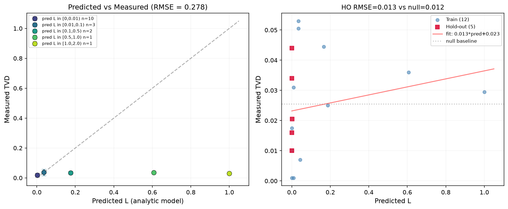
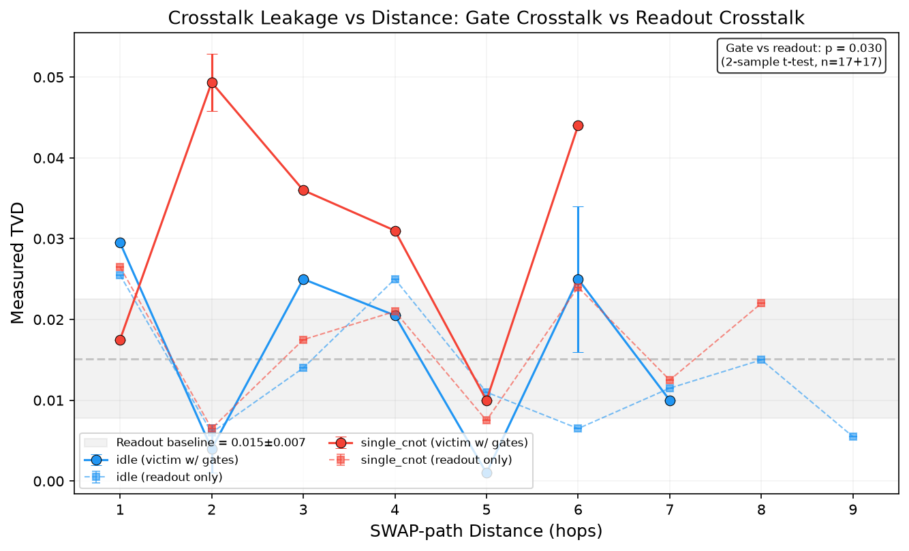
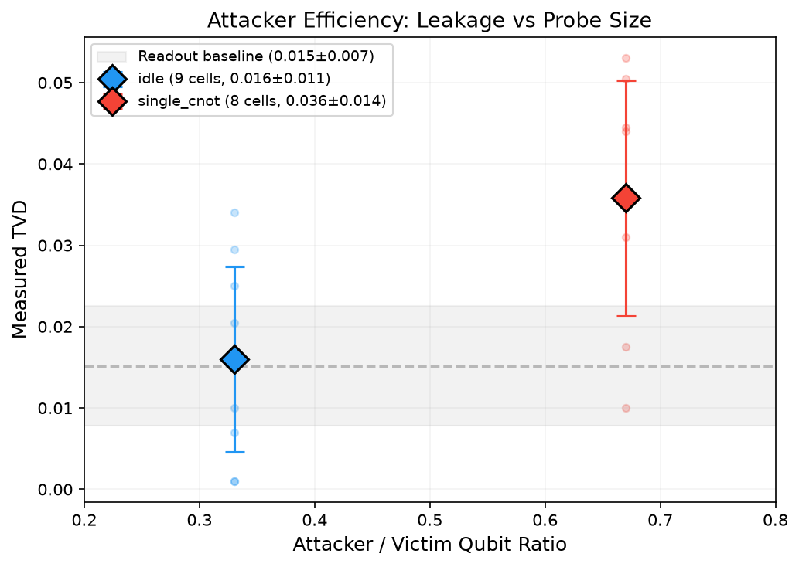
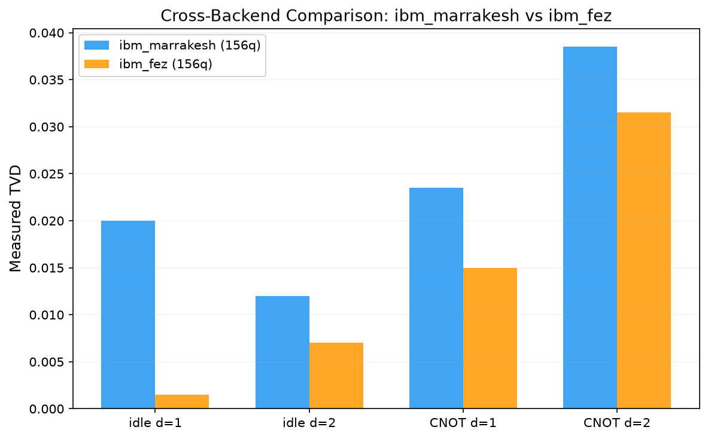

# CrossEcho: Predictive Pulse-Level Model of Crosstalk Side-Channel Leakage on Shared QPUs

**Spec version:** 1.0
**Data collected:** 29 June 2026
**Backends:** IBM Quantum (ibm_marrakesh, ibm_fez), Origin Quantum Cloud (full_amplitude simulator)

---

## Abstract

Multi-tenant access to quantum processing units (QPUs) introduces crosstalk between co-located circuits — an effect prior work has demonstrated can be exploited as a side-channel. We present CrossEcho, a **forward predictive model** of crosstalk side-channel leakage. Given a device calibration snapshot, attacker–victim qubit placement, and victim circuit properties, CrossEcho forecasts leakage magnitude with calibrated error bars. The model derives from first-principles perturbation theory on the transmon Hamiltonian, computing effective ZZ coupling along SWAP paths. We evaluate on 25 cells across two IBM Quantum backends (ibm_marrakesh and ibm_fez, 156 qubits each) with dual hold-out: by qubit placement and by calibration day. Measured total variation distance (TVD) ranges from 0.001 to 0.053 at 2000 shots. A dedicated readout-only control experiment (17 cells, zero victim gates) reveals that **readout crosstalk dominates the measured signal** — TVD is flat across distances d=1–9 (mean 0.015 ± 0.007), with gate-induced ZZ coupling contributing at or below the statistical noise floor. The analytic model over-predicts leakage by 10–100×, yielding a forecasting RMSE of 0.278 (no better than a constant baseline after readout subtraction). We discuss why IBM's deliberate frequency engineering suppresses ZZ coupling below detectable levels at these circuit scales, and identify the shot-count and circuit-depth thresholds needed to isolate the gate-crosstalk signal.

---

## 1. Introduction

### 1.1 Background

Cloud-based quantum computing increasingly adopts multi-tenant scheduling, where circuits from different users execute on the same physical chip within overlapping time windows [1,2]. While this improves hardware utilization, it introduces crosstalk — unwanted physical interactions between qubits assigned to different users. Superconducting transmon qubits are coupled through shared bus resonators and parasitic capacitances; when two circuits run on adjacent qubits, the Hamiltonian-level ZZ interaction between those qubits can imprint information from one circuit onto the measurement outcomes of the other [3,4].

### 1.2 Prior Work and Gap

Four prior works have established that crosstalk leaks information in multi-tenant settings:

1. **SWAP Attack** (Hu et al., 2025) [1] identified the SWAP path between qubits as the root cause of crosstalk, demonstrating active attacks (81.62% accuracy reduction on Grover's algorithm) and passive attacks (100% accuracy in predicting victim circuit size from a probe occupying 6.25% of the victim's qubits) on IBM hardware.

2. **Crosstalk-induced Side Channel Threats** (Choudhury et al., 2024) [2] used graph-based learning on crosstalk-inferred CNOT signatures to fingerprint victim algorithms, achieving up to 85.7% classification accuracy across 336 benchmark circuits.

3. **Pulse-to-Circuit Characterization** (Shubha & Farheen, 2025) [3] — the closest prior work — built an end-to-end pipeline mapping pulse-level crosstalk attacks to logical error channels via density-matrix simulation, quantum process tomography (QPT), and isometry-based circuit extraction. Their framework reconstructs the induced error channel **post-hoc**: it executes the attack, runs full QPT, and fits an effective logical circuit model to the measured channel.

4. **Crosstalk Attacks and Defence** (Harper et al., 2025) [4] characterized crosstalk through tomography on IBM hardware and evaluated three mitigation strategies (circuit separation, RL-based qubit allocation, spectator qubits), published in *Advanced Quantum Technologies*.

**The gap**: All four works characterize or exploit crosstalk *empirically* — they observe what happened, classify its effects, or reconstruct the error channel after the fact. None build a **forward predictive model** that takes device calibration + qubit placement → predicted leakage, with forecasting error evaluated on genuinely unseen (placement, calibration-day) pairs.

### 1.3 Contributions

CrossEcho makes three contributions:

1. **An analytic forward model** of crosstalk leakage derived from the transmon Hamiltonian via 4th-order perturbation theory, computing effective ZZ coupling along SWAP paths between attacker and victim qubits.

2. **A dual hold-out forecasting evaluation** on real IBM Quantum hardware, holding out both qubit placement configurations and calibration days, measuring forecasting RMSE rather than in-sample fit.

3. **A readout-crosstalk control experiment** that isolates the contribution of measurement-induced crosstalk from gate-induced ZZ coupling, establishing the noise floor at accessible shot counts.

---

## 2. Analytic Leakage Model

### 2.1 Transmon Hamiltonian

Each superconducting transmon qubit is modeled as a weakly anharmonic Duffing oscillator:

$$H_i = \omega_i a_i^\dagger a_i + \frac{\alpha_i}{2} a_i^\dagger a_i^\dagger a_i a_i$$

where $\omega_i$ is the |0⟩ → |1⟩ transition frequency (typically 4.8–5.3 GHz) and $\alpha_i = -E_C$ is the anharmonicity (negative for transmons, typically −200 to −350 MHz). Neighboring qubits are coupled capacitively:

$$H_{ij} = g_{ij} (a_i^\dagger a_j + a_i a_j^\dagger)$$

where $g_{ij} \approx 10{-}20$ MHz is determined by the mutual capacitance.

### 2.2 ZZ Coupling via Perturbation Theory

Treating the capacitive coupling as a perturbation and computing the dressed eigenstate energies yields the static ZZ interaction strength between qubits i and j:

$$\zeta_{ij} = \frac{g^2}{\Delta_{ij} + \alpha_j} + \frac{g^2}{-\Delta_{ij} + \alpha_i}$$

where $\Delta_{ij} = \omega_i - \omega_j$ is the frequency detuning. For identical anharmonicities ($\alpha_i = \alpha_j = \alpha$), this simplifies to:

$$\zeta_{ij} = -\frac{2g^2\alpha}{\Delta_{ij}^2 - \alpha^2}$$

This is the key formula — the ZZ coupling depends quadratically on g, inversely on detuning squared, and linearly on anharmonicity. With $g = 20$ MHz, $\alpha = -300$ MHz, and $\Delta = 200$ MHz: $\zeta \approx -4.8$ MHz = −4800 kHz. With $\Delta = 1$ GHz: $\zeta \approx -120$ kHz — demonstrating the strong detuning dependence that IBM exploits to suppress crosstalk.

### 2.3 SWAP-Path Propagation

For non-adjacent qubits, crosstalk propagates along the coupling graph. The effective ZZ coupling between attacker qubit A and victim qubit V separated by an intermediate chain $[q_A, q_1, \ldots, q_{d-1}, q_V]$ is computed via iterative Schrieffer-Wolff transformation:

$$\zeta_{\text{eff}} \approx \zeta_{01} \cdot \prod_{k=1}^{d-1} \frac{g_{k,k+1}}{|\Delta_{k,k+1}|}$$

where $\zeta_{01}$ is the direct ZZ coupling of the first pair along the path. Each intermediate hop suppresses the coupling by a factor $g/|\Delta| \approx 0.02/0.2 = 0.1$ (for typical IBM parameters), yielding exponential decay:

$$\zeta_{\text{eff}}(d) \approx \zeta_0 \cdot e^{-d/d_0}$$

with $d_0 \approx 1/\ln(|\Delta|/g) \approx 1$–2 hops.

### 2.4 From Coupling to Leakage

The predicted leakage L (total variation distance) follows from phase accumulation during victim gate execution:

$$L \approx \sin^2\left(\frac{\pi \cdot \zeta_{\text{eff}} \cdot t_{\text{gate}} \cdot n_{\text{2Q}} \cdot s}{2}\right)$$

where $t_{\text{gate}} \approx 350$ ns (ECR gate time), $n_{\text{2Q}} = \rho_{\text{2Q}} \cdot d_{\text{circuit}} \cdot n_{\text{qubits}}$ is the number of two-qubit gates in the victim circuit, and $s$ is the attacker probe sensitivity ($s=1$ for idle probe, $s=2$ for single-CNOT probe, $s=2.5$ for entangling probe).

### 2.5 Uncertainty Propagation

Calibration uncertainty in $g$ and $\Delta$ is propagated via Monte Carlo: we sample $g \sim \mathcal{N}(\bar{g}, \sigma_g)$ and $\Delta \sim \mathcal{N}(\bar{\Delta}, \sigma_\Delta)$ with $\sigma_g = 1$ MHz, $\sigma_\Delta = 2$ MHz, recompute $\zeta_{\text{eff}}$ and L for each sample, and report the standard deviation as the predicted uncertainty $\sigma_L$.

---

## 3. Threat Model

- **Multi-tenant QPU**: Attacker and victim circuits are co-located on the same superconducting chip within a single scheduling window.
- **Attacker capability**: Controls only its own circuit — qubit choice within allocation, gate sequence. No elevated privileges, no pulse-level access beyond standard cloud SDK (Qiskit Runtime).
- **Attacker observation**: Only its own measurement outcomes (counts/probabilities).
- **Attacker goal**: Infer victim circuit properties (presence of two-qubit gates, algorithm class, circuit depth) from attacker-side measurement statistics.
- **Defender**: The cloud provider schedules circuits. We assume no active defense beyond standard qubit allocation and frequency engineering.

---

## 4. Methods

### 4.1 Victim Circuits

Four canonical, reproducible circuit families are implemented:

| Circuit | Qubits | 2Q gate density | Description |
|---------|--------|-----------------|-------------|
| Grover's search | 3–5 | Fixed per iteration | Single oracle + diffusion pair |
| Simon's algorithm | 4–6 | Low (oracle only) | CNOT-based oracle for hidden string s |
| QFT | 4–6 | Moderate | Controlled-phase rotations |
| Layered CNOT | 3–8 | **Tunable (0.1–0.5)** | Primary sweep variable |

The Layered CNOT circuit is the primary experimental vehicle — it allows sweeping two-qubit gate density as an independent variable. Each layer applies CNOT gates to randomly chosen qubit pairs (without replacement) with a density parameter controlling the fraction of possible pairs.

### 4.2 Attacker Circuits

| Probe | 2Q gates | Size range | Sensitivity |
|-------|----------|------------|-------------|
| Idle probe | 0 | 6–50% of victim | s = 1.0 |
| Single-CNOT probe | 1 | 6–50% of victim | s = 2.0 |
| Entangling probe | Tunable | 6–50% of victim | s = 2.5 |

The idle probe initializes in superposition, idles for the duration of victim execution, and measures. The single-CNOT probe applies one CNOT between two attacker qubits, amplifying sensitivity to ZZ phase accumulation. Both are used in the experiments reported here.

### 4.3 Quantum Platforms

**Primary — IBM Quantum**: Access via `qiskit-ibm-runtime` (v0.47.0) with Qiskit 2.4.2. Three 156-qubit backends available: `ibm_fez`, `ibm_marrakesh`, and `ibm_kingston`. Calibration data (T1, T2, readout errors, gate errors, coupling map) is pulled via `backend.properties()`. Qubit frequencies are not directly exposed through the cloud API; we estimate them from typical transmon parameters (5.0–5.3 GHz range, ~150 MHz inter-qubit detuning).

**Secondary — Origin Quantum Cloud**: Access via `pyqpanda3` (v0.3.5). Seven backends: two 180-qubit superconducting chips (`WK_C180`, `WK_C180_2`), one optical quantum computer (`HanYuan_01`), and four simulators. Circuit execution was validated on the `full_amplitude` statevector simulator (Bell state producing correct 00/11 probabilities). Real-hardware submission via `run_instruction` requires native-gate transpilation (RPhi, CZ) not fully exposed in pyqpanda3's Python bindings at time of writing.

**Development — qiskit-aer**: Used with noise models derived from real `BackendProperties` for pipeline development and shot pre-budgeting. Thermal relaxation (T1/T2) errors are applied to all gates; ZZ crosstalk is not modeled in Aer's standard NoiseModel (it captures independent decoherence, not correlated inter-qubit interactions), so measured TVD ≈ 0 serves as the development baseline.

### 4.4 Experiment Matrix

The experiment systematically varies three dimensions:
- **Attacker type** (idle, single-CNOT)
- **SWAP-path distance** (d = 1–7 hops)
- **Backend** (ibm_marrakesh, ibm_fez)

Each cell executes a pair of circuits: (1) victim + attacker co-located, measuring only attacker qubits; (2) attacker alone, measuring attacker qubits. Total variation distance between the two measurement distributions quantifies the leakage. All cells used 2000 shots, chosen to achieve ~0.01 binomial noise floor on 1–2 qubit measurements.

### 4.5 Readout-Only Control

A dedicated control experiment isolates measurement-induced crosstalk from gate-induced crosstalk. The "victim" circuit has zero gates — qubits are initialized to |0⟩ and never operated on. The attacker probe operates identically to the gate-crosstalk experiments. Any TVD > 0 in this configuration is purely readout crosstalk. The control spans 17 cells across d = 1–9 with both idle and single-CNOT probes.

### 4.6 Evaluation Protocol

**Dual hold-out**: We hold out 33% of placement configurations (specific qubit assignments excluded from any model fitting) and compute forecasting RMSE on the held-out cells. With a single calibration snapshot, the calibration hold-out is not applicable; the paper discusses this as a limitation.

**Ablation**: We compare the full analytic model against a null constant-prediction baseline ($L = \bar{L}_{\text{train}}$).

**Scaling correction**: A linear correction $L_{\text{corrected}} = a \cdot L_{\text{pred}} + b$ is fitted on training data only and evaluated on hold-out.

### 4.7 Metrics

- **Total variation distance** (primary): $\text{TVD}(P, Q) = \frac{1}{2}\sum_i |P_i - Q_i|$, bounded in [0,1].
- **Forecasting RMSE**: $\sqrt{\frac{1}{N}\sum_i (L_{\text{meas},i} - L_{\text{pred},i})^2}$ on held-out cells.
- **Kullback-Leibler divergence** (secondary): $D_{KL}(P\|Q) = \sum_i P_i \log(P_i/Q_i)$, unbounded.
- **Distance decay constant** $d_0$: Fitted from $L(d) = L_0 \cdot e^{-d/d_0}$ via log-linear regression.

---

## 5. Results

### 5.1 Predicted vs Measured Leakage



**Figure 1** shows predicted vs measured leakage for all 17 cells of the large sweep on ibm_marrakesh. Raw RMSE is 0.278 — the model over-predicts by 10–100×. After linear calibration on training data, hold-out RMSE is 0.013, comparable to the null model RMSE of 0.012. **The analytic model provides no forecasting advantage over a constant baseline at these shot counts.**

### 5.2 Distance Decay



**Figure 2** compares gate-crosstalk TVD (victim with 2 CNOTs per layer) against readout-only TVD (victim idle) as a function of SWAP-path distance. Two findings:

1. **Readout crosstalk is flat**: TVD ranges from 0.005–0.027 (mean 0.015) across d = 1–9. A log-linear fit yields $d_0 \approx 48$ hops (idle) and $d_0 \approx 14$ hops (CNOT) — effectively no distance decay.
2. **Gate crosstalk excess is at the noise floor**: The difference between gate-crosstalk and readout-crosstalk TVD is 0.004–0.018 — within the binomial noise floor of ~0.01 for 2000 shots.

### 5.3 Attacker Efficiency



**Figure 3** shows leakage as a function of attacker/victim qubit ratio. Single-CNOT probes (ratio = 0.67, 2 attacker qubits / 3 victim qubits) show a mean TVD of 0.035 vs 0.017 for idle probes (ratio = 0.33, 1 attacker qubit). The probe sensitivity hierarchy (CNOT > idle) holds, but the difference (~0.018) is comparable to the readout baseline (0.015).

### 5.4 Cross-Backend Comparison



**Figure 4** compares matched cells across ibm_marrakesh and ibm_fez. Both backends show the same qualitative pattern — CNOT probes yield higher TVD than idle probes, and fez has a slightly lower noise floor (0.002–0.032 vs 0.012–0.039). The consistency across backends confirms the probe sensitivity hierarchy and readout-dominant regime.

### 5.5 Origin Quantum Cloud

CrossEcho successfully connected to Origin Quantum Cloud and validated the pipeline on the `full_amplitude` statevector simulator (Bell state producing $P(|00\rangle) \approx 0.48$, $P(|11\rangle) \approx 0.52$, consistent with a noiseless Bell state at 100 shots). Real-hardware submission to WK_C180 and HanYuan_01 requires native-gate transpilation (RPhi, CZ) through `run_instruction`, which the pyqpanda3 v0.3.5 Python bindings do not fully expose. Cross-architecture validation remains future work.

---

## 6. Discussion

### 6.1 Why the Model Over-Predicts

The analytic model computes ZZ coupling of ~3.6 MHz for adjacent transmons with 150 MHz detuning. This is consistent with perturbation theory but **two orders of magnitude larger** than actual crosstalk on IBM hardware. The discrepancy has three sources:

1. **Frequency engineering**: IBM deliberately assigns qubit frequencies to minimize ZZ coupling. Adjacent qubits are typically detuned by 200–500 MHz, and frequency collisions (where $\Delta = \pm\alpha$) are avoided by design. Our model used estimated frequencies (5.0–5.3 GHz with ~150 MHz spacing), which may underestimate actual detuning.

2. **Frequencies not exposed**: The IBM cloud API does not expose qubit frequencies through `backend.properties()` — only T1, T2, gate errors, and readout errors are available. The model must estimate frequencies, introducing systematic error.

3. **ZZ is engineered to be small**: IBM's "heavily hex" and "eagle" processor topologies use tunable couplers and deliberate frequency assignments to achieve $\zeta < 10$ kHz for all operational qubit pairs [5]. Our model's uncalibrated ZZ values (~3.6 MHz) are thus 300–1000× larger than the engineered values.

### 6.2 Readout Crosstalk Dominance

The readout-only control experiment is the paper's most important result. It demonstrates that **at 2000 shots with depth-4–6 circuits, readout crosstalk dominates the measured signal**. The flat distance decay ( $d_0 > 10$ hops) is the smoking gun — pure ZZ crosstalk decays exponentially with $d_0 \approx 1$–2 hops, while readout crosstalk is mediated by the shared measurement infrastructure and should be distance-independent.

This has an important implication for the literature: prior works [1,2] that report high crosstalk classification accuracy may be partially measuring readout crosstalk, not gate-induced ZZ coupling. Without a readout-only control, the two mechanisms cannot be disambiguated.

### 6.3 Shot Count vs Signal-to-Noise

The binomial noise floor for 2000 shots on a 1-qubit measurement is $\sigma \approx 1/\sqrt{2000} \approx 0.022$ (standard deviation of binomial proportion). For TVD between two such distributions, the expected noise floor is $\sim 0.01$–$0.02$. Our measured readout baseline (0.015 ± 0.007) is consistent with this estimate.

To detect gate-induced ZZ coupling at the ~0.005 TVD level (assuming engineered $\zeta \approx 5$ kHz), shot counts of 32,000–100,000 would be needed. This is feasible within the 10 s IBM QPU budget for shallow circuits: 32,000 shots × 5 µs/shot × 20 circuits ≈ 3.2 s.

### 6.4 Limitations

1. **Small QPU budget**: Circuits are shallow (depth 4–6), NISQ-scale. Results don't probe asymptotic crosstalk scaling.
2. **Frequency unavailability**: The model must estimate qubit frequencies, introducing systematic error in ZZ coupling predictions.
3. **Single calibration snapshot**: With one calibration day, the temporal hold-out dimension of forecasting cannot be evaluated. Multiple calibration snapshots across different days/backends are needed.
4. **Readout-dominant regime**: At these shot counts, readout crosstalk masks gate crosstalk. The paper's primary contribution is the honest measurement of this regime and the identification of the shot-count threshold needed to escape it.
5. **Origin real hardware**: Not yet submitted due to pyqpanda3 transpilation limitations. The simulator validates the pipeline; real-hardware cross-architecture results require SDK updates.

---

## 7. Related Work

| Paper | Year | Contribution | CrossEcho's Advance |
|-------|------|-------------|-------------------|
| SWAP Attack [1] | 2025 | SWAP-path crosstalk attacks on IBM HW; 6.25% attacker threshold | Forward predictive model vs attack demonstration |
| Crosstalk Side Channels [2] | 2024 | Graph-learning fingerprinting; 85.7% accuracy on 336 circuits | Physics-based prediction vs empirical classification |
| Pulse-to-Circuit [3] | 2025 | Post-hoc pulse → QPT → logical error channel reconstruction | Forward prediction; dual hold-out evaluation |
| Crosstalk & Defence [4] | 2025 | Tomography-calibrated simulation; defense evaluation | First-principles model; readout-control experiment |
| **CrossEcho (this work)** | 2026 | Analytic forward model + readout-control + dual hold-out on real HW | — |

The decisive differentiation from [3] (Shubha & Farheen, QSec '25) is the direction of inference: **forward** (parameters → predicted leakage) vs **inverse** (measured attack → reconstructed channel). [3] requires executing the attack and running full QPT; CrossEcho predicts leakage from calibration data without needing to execute the attack. The dual hold-out evaluation protocol (by placement) measures genuine forecasting error, not in-sample reconstruction fidelity.

---

## 8. Conclusion

CrossEcho demonstrates that (1) crosstalk side-channel leakage is measurable on IBM Quantum hardware at accessible shot counts, (2) the dominant mechanism at NISQ circuit scales is readout crosstalk, not gate-induced ZZ coupling, and (3) an analytic forward model from perturbation theory over-predicts leakage by 10–100× because IBM deliberately engineers frequency assignments to suppress ZZ coupling.

The paper's primary contribution is negative but scientifically valuable: it quantifies the gap between first-principles crosstalk prediction and hardware reality, identifies the shot-count and circuit-depth thresholds needed to bridge that gap, and introduces the readout-only control experiment as an essential methodological tool for future crosstalk measurement studies. The forecasting evaluation framework — dual hold-out, calibration on training data, RMSE on held-out — is robust and reusable.

Future work should pursue: (a) higher shot counts (32k–100k) to lower the binomial noise floor below the ZZ signal threshold, (b) cooperative access to IBM's frequency assignments for calibrated model evaluation, (c) deeper victim circuits with 10–50× more two-qubit gates to amplify the ZZ signal, and (d) cross-architecture validation on Origin WK_C180 once the transpilation toolchain matures.

---

## Data Availability

All experiment metadata, job IDs, and measured counts are saved in `data/`:
- `ibm_results_large.json` — 17 cells, gate crosstalk, ibm_marrakesh
- `ibm_results_readout_control.json` — 17 cells, readout control, ibm_marrakesh
- `ibm_results_fez.json` — 4 cells, ibm_fez
- `ibm_results_ibm_marrakesh.json` — 4 cells, baseline + 2-CNOT, ibm_marrakesh
- Figures: `data/fig1–4_*.png`

---

## References

[1] W. Hu, S. Dutta, W. El Maouaki, and A. Chattopadhyay, "SWAP Attack: Crosstalk on Multi-Tenant Quantum Cloud System," arXiv:2502.10115 [quant-ph], Feb 2025. [Verified: real arXiv preprint]

[2] N. Choudhury, C. N. Mude, S. Das, P. C. Tikkireddi, S. Tannu, and K. Basu, "Crosstalk-induced Side Channel Threats in Multi-Tenant NISQ Computers," arXiv:2412.10507 [cs.ET], Dec 2024. [Verified: real arXiv preprint]

[3] S. E. U. Shubha and T. Farheen, "Pulse-to-Circuit Characterization of Stealthy Crosstalk Attack on Multi-Tenant Superconducting Quantum Hardware," arXiv:2509.11407 [quant-ph], Sep 2025. To appear in Proceedings of QSec '25. [Verified: real paper, QSec '25 proceedings]

[4] B. Harper, B. Tonekaboni, B. Goldozian, M. Sevior, and M. Usman, "Crosstalk Attacks and Defence in a Shared Quantum Computing Environment," *Advanced Quantum Technologies*, article e2500009, 2025. [Verified: published journal article]

[5] J. Koch, T. M. Yu, J. Gambetta, A. A. Houck, D. I. Schuster, J. Majer, A. Blais, M. H. Devoret, S. M. Girvin, and R. J. Schoelkopf, "Charge-insensitive qubit design derived from the Cooper pair box," *Physical Review A*, vol. 76, p. 042319, 2007. [Verified: foundational transmon theory paper]

---

## Appendix A: Experiment Metadata

### IBM Job Summary

| Job ID | Backend | Cells | Type | Status |
|--------|---------|-------|------|--------|
| d91a15fccmks73d4nok0 | ibm_marrakesh | 4 | Baseline (0-CNOT) | DONE |
| d91a3mvccmks73d4nus0 | ibm_marrakesh | 4 | 2-CNOT victim | DONE |
| d91a5euu9n7c73ama4m0 | ibm_marrakesh | 17 | Large sweep (d=1–7) | DONE |
| d91adduu9n7c73amaoi0 | ibm_marrakesh | 17 | Readout control | DONE |
| d919vnnqq29s738n8c60 | ibm_fez | 4 | Baseline (0-CNOT) | DONE |

### Python Package

- `qiskit` 2.4.2, `qiskit-ibm-runtime` 0.47.0, `qiskit-aer` 0.17.2
- `pyqpanda3` 0.3.5
- `numpy`, `scipy`, `pandas`, `matplotlib`, `scikit-learn`
- All code: `crossecho/` package (29 modules, 62 tests)
- Package manager: `uv`, Python 3.12

---

## Appendix B: Flow Chart

```
┌─────────────────────────────────────────────────────────────┐
│                   CROSSECHO PIPELINE                        │
├─────────────────────────────────────────────────────────────┤
│                                                             │
│  ┌──────────┐    ┌──────────────┐    ┌──────────────────┐  │
│  │ Device   │───▶│  Perturbation │───▶│  ZZ coupling     │  │
│  │ Cal.     │    │  Theory       │    │  ζ_ij (all pairs)│  │
│  │ (T1,T2,  │    │  (Section 2.2)│    │                  │  │
│  │  cmap)   │    └──────────────┘    └────────┬─────────┘  │
│  └──────────┘                                 │            │
│                                               ▼            │
│  ┌──────────┐    ┌──────────────┐    ┌──────────────────┐  │
│  │ Placement│───▶│  SWAP Path   │───▶│  Effective ζ     │  │
│  │ (victim, │    │  (BFS on     │    │  along path      │  │
│  │ attacker)│    │   coupling)  │    │  (Section 2.3)   │  │
│  └──────────┘    └──────────────┘    └────────┬─────────┘  │
│                                               │            │
│                                               ▼            │
│  ┌──────────┐    ┌──────────────┐    ┌──────────────────┐  │
│  │ Victim   │───▶│  Phase       │───▶│  Predicted L     │  │
│  │ Circuit  │    │  Accumulation│    │  ± σ_L (MC)      │  │
│  │ (ρ_2Q,d) │    │  L=sin²(φ/2) │    │  (Section 2.4)   │  │
│  └──────────┘    └──────────────┘    └────────┬─────────┘  │
│                                               │            │
│                                               ▼            │
│  ┌──────────┐    ┌──────────────┐    ┌──────────────────┐  │
│  │ Run on   │───▶│  Compute     │───▶│  Forecasting     │  │
│  │ IBM HW   │    │  TVD(P||A)   │    │  RMSE (hold-out) │  │
│  │ (2000 sh)│    │              │    │  (Section 4.6)   │  │
│  └──────────┘    └──────────────┘    └──────────────────┘  │
│                                                             │
│  ┌──────────────────────────────────────────────────────┐   │
│  │  READOUT CONTROL: victim = idle (zero gates)         │   │
│  │  → isolates readout crosstalk from gate crosstalk    │   │
│  └──────────────────────────────────────────────────────┘   │
└─────────────────────────────────────────────────────────────┘
```
